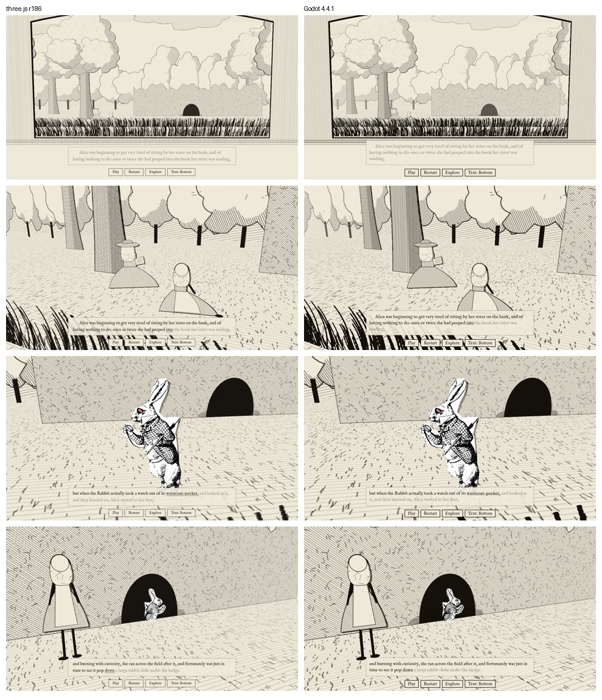

# Gate A: three.js vs Godot
Date: 2026-10-10
Status: **Decided 2026-10-10: three.js. Packaging test passed.** The owner tried both builds and preferred three.js for how the text reads and how smoothly it runs. The Electron + Steam packaging test passed on Windows (results below). Low-end hardware is still untested.

The same riverbank slice is built twice with identical art, audio, timings and staging:
- **three.js r186** with Vite (`src/`, `index.html`)
- **Godot 4.4.1**, Compatibility renderer (`godot/`)

The placeholder art is drawn in code for the web build and exported to PNG for Godot (`tools/bake_placeholders.mjs`), so both show the same pixels.

## Results
| Criterion | three.js | Godot | Edge |
|---|---|---|---|
| **Look** | Same | Same, once flat textures were set to clamp (repeat caused edge lines) | Tie |
| **Text and typography** (the core of a literary game) | HTML/CSS: real typesetting, three layouts in about 30 lines of CSS, click-to-seek on any word, screen-reader friendly | RichTextLabel with BBCode, rebuilt every word; layouts set by hand-placed anchors; screen-reader support is limited | **three.js** |
| **Staging and timeline authoring** | Cues in code today. A visual editor means adding Theatre.js or building one. | AnimationPlayer gives a visual timeline you can scrub in the editor, with no extra tools | **Godot** |
| **Puppet animation** | Node hierarchies plus tweening; nothing built in for cutout rigs | Node3D hierarchies plus AnimationPlayer keyframes; Skeleton2D exists but our puppets are 3D cards | Godot, slightly |
| **Audio sync** | `audio.currentTime` is accurate | Needed playback position plus mix-latency compensation; works | Tie |
| **Saves** | localStorage on the web, or the file system under Electron | Built in (`user://`, ConfigFile) | Tie |
| **Steam packaging** | Needs Electron (about 150 MB with bundled Chromium) or Tauri (system webview; on Linux and Steam Deck that's WebKitGTK, which has weaker WebGL). Steamworks via steamworks.js. **Not yet tested.** | Native exports for Windows, macOS, Linux and Steam Deck; GodotSteam for Steamworks. **Export not yet tested.** | **Godot** |
| **Web demo / free trial** | Runs in any browser as is | Web export works but is heavier (large wasm download) | three.js |
| **Building it with Claude Code** | Fast: plain files, my browser test harness, readable diffs | Workable: headless screenshots work here, and scripts and scenes are text. The editor GUI can't be used from here, but you can use it on your machine. | three.js, slightly |
| **Code size for this slice** | 544 lines of JS plus 132 of HTML/CSS | 850 lines of GDScript, including UI built in code | three.js |
| **Performance** | Windows desktop build, GeForce RTX 3060 Ti: steady 60 fps, average and worst frame 16.7 / 16.8 ms (locked to the display) | Not measured | three.js meets the target on mid-range hardware |

## Found in both
- Explore mode: from the right side of the walkable area, the end of a grass strip came into view. The strips were widened in both builds. A full edge sweep across the walkable area is still needed.

## Recommendation
**three.js, provided it passes a packaging test.** The book's text is the heart of this game, and the web stack is clearly better at typesetting, reading layouts and accessibility. Godot's real advantages are its visual animation timeline and native Steam builds. The timeline can be matched with Theatre.js or a small cue editor. Packaging is the real risk, and it needs a test before the decision is final:

1. Wrap the slice in Electron and build for Windows and Linux.
2. Run it on a Steam Deck or low-end laptop: target a steady 60 fps, with audio staying in sync.
3. Try the Steamworks overlay via steamworks.js.

If any of these fails badly, switch to Godot. The port took one session, so switching early is cheap.

## Running the Godot build
Install Godot 4.4.1 from godotengine.org, open `godot/project.godot` in the editor, and press Play.

To take screenshots from the command line:
`godot --path godot -- --smoke=/absolute/output/dir`

## Packaging test results (2026-10-10)
| Check | Result |
|---|---|
| Desktop build (Electron 44, `npm run package:win` / `package:linux`) | ✅ Builds on GitHub's Windows and Linux machines (`.github/workflows/desktop.yml`) |
| Packaged app plays with no errors | ✅ Automated run of the Linux build in CI |
| Runs on the owner's Windows PC | ✅ |
| Steam connection (steamworks.js, test app 480 "Spacewar") | ✅ Connected; Steam shows "Playing Spacewar" |
| Steam overlay (Shift+Tab) | ✅ Works |
| Performance, RTX 3060 Ti | ✅ 60 fps, worst frame 16.8 ms |
| Performance, low-end hardware (integrated graphics or Steam Deck) | ⏳ Not tested yet |
| Code signing (removes the Windows "protected your PC" warning) | ⏳ Needed before release |
